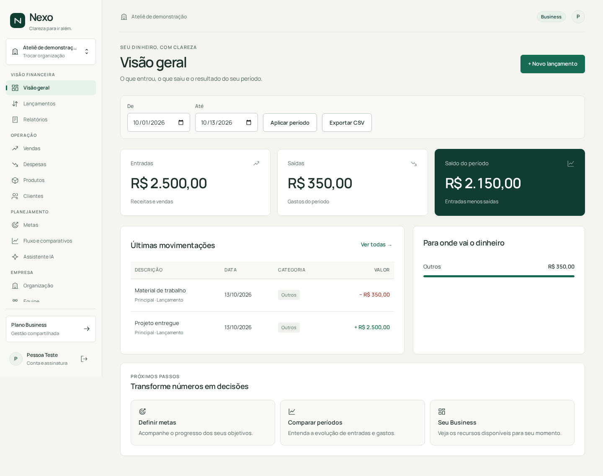
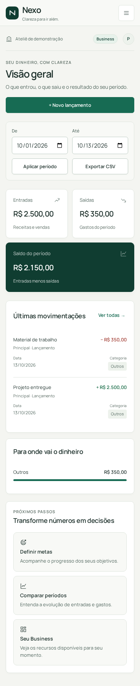
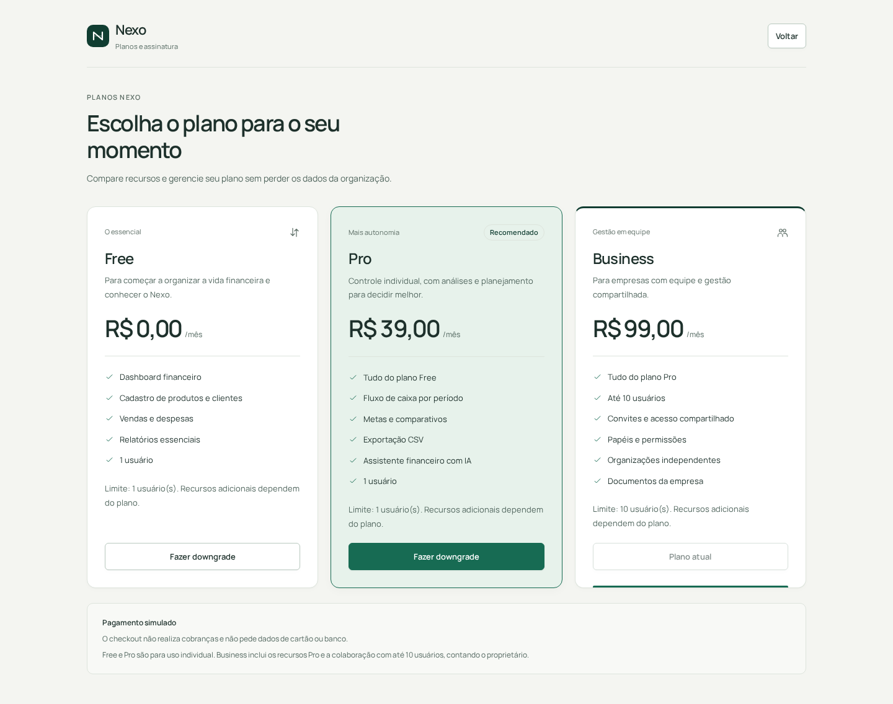
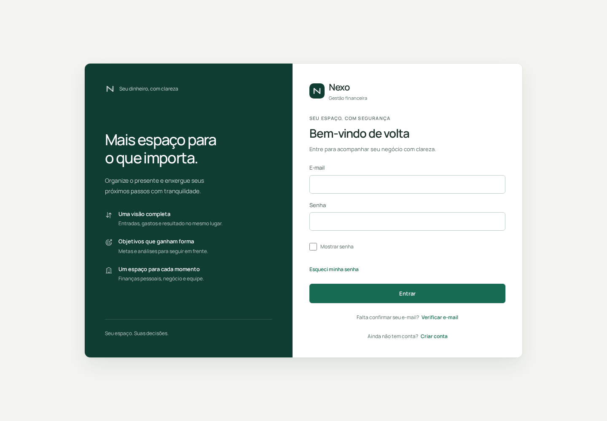

# Sistema visual do Nexo

Direção: verde profundo, superfícies claras e acolhedoras, tipografia editorial contida e leitura financeira precisa. Profundidade por contraste, borda e sombras leves; movimento apenas para navegação, estados e elementos interativos.

## Organização

- `frontend/app/globals.css`: tokens, reset, tipografia, botões, campos e superfícies compartilhadas.
- `navigation.css`: navegação, contexto da organização e drawer mobile nativo de `dialog`.
- `product.css`: módulos financeiros, metas, estados vazios, organização e Business.
- `tables.css` e `refinement.css`: históricos comerciais e relatórios.
- `auth.css`, `saas.css`, `checkout.css`, `pro.css` e `ia.css`: composição dos respectivos fluxos.

As antigas camadas `polish.css`, `signature.css` e `saas-extra.css` foram removidas. Estilos utilizados do onboarding foram incorporados a `saas.css`. Novos estilos devem usar os tokens, em vez de acrescentar overrides decorativos ao final de outra folha.

## Tipografia e movimento

Manrope variável, subset Latin (acentos portugueses incluídos), hospedada localmente via `next/font/local`, com `display: swap` e fallback ajustado pelo Next. Arquivo WOFF2 de 24,8 KB proveniente de `@fontsource-variable/manrope@5.3.0`, obtido pelo npm com verificação de integridade; licença SIL OFL em `frontend/app/fonts/OFL.txt`. Não há dependência JavaScript nova nem requisição externa de fontes em runtime ou build.

Tokens de movimento: 140, 220 e 320 ms. Entrada de conteúdo, mensagens e progressos usa opacity/transform; os estados interativos usam transições curtas. `prefers-reduced-motion: reduce` desativa animações e transições globalmente.

## Preservação

APIs, autorização, planos, contratos de autenticação e provedores de e-mail são preservados. Revisão visual usa apenas o banco dedicado `nexo_test`, contas sintéticas e serviços locais, sem publicação.

## Checkpoint da base

TypeScript, lint, build de todas as rotas e 25 testes unitários passaram. Primeira inspeção no Chromium em 1440 e 390 px verificou a fonte carregada, ausência de overflow horizontal e fechamento por Escape com retorno de foco no menu mobile. A passagem completa das telas e demais larguras continua nos próximos blocos.

## Checkpoint financeiro

Cards de saldo com contraste próprio e ícones funcionais, tabela móvel com data/categoria/ações preservadas e gráficos baseados nos valores retornados pelo backend. O gráfico diário possui eixos legíveis, legenda, consulta por ponteiro, controle de dia operável por teclado/toque e tabela alternativa. Metas concluídas recebem tratamento discreto e progresso animado.

Os 10 cenários de Playwright passaram contra backend e PostgreSQL reais de teste, incluindo as seis transições de plano, persistência, permissões, convite, documentos, cadastro e recuperação. O teste de membro foi direcionado à lista de equipe: o novo nome de usuário na navegação tornou o antigo seletor global ambíguo. Nenhuma asserção funcional foi removida.

## Checkpoint das experiências

Autenticação com composição editorial e formulário direto no celular; checklist de senha legível e sem mudanças na política. Onboarding com seleção, transição curta e foco no título da nova etapa. Free, Pro e Business com hierarquia distinta, preços e benefícios vindos do catálogo, destaque do Pro e identificação do plano atual. Checkout preserva simulação explícita, consentimento, métodos, falhas e confirmação.

Business recebe identificação de papéis, navegação entre espaços, arquivos com seleção acessível e drag/drop, indicação do tamanho real e quota. O assistente mantém os contratos existentes, apresenta disponibilidade real e oferece estados de carregamento/resposta e atalhos para ferramentas já disponíveis.

Adicionado `@axe-core/playwright@4.13.0` apenas como dependência de desenvolvimento. Auditoria manual automatizada no Chromium: **46 páginas/viewport**, em 1440 e 390 px, sem violações WCAG A/AA detectadas pelo axe e sem overflow horizontal. Isso não substitui avaliação humana de acessibilidade. A primeira execução da suíte ampliada revelou foco do drawer, contraste e overflow do input oculto; esses pontos foram corrigidos. A inspeção visual também corrigiu o campo de progresso que ficava estreito em 360 px.

TypeScript, lint, 25 testes unitários e build de todas as rotas passaram antes deste checkpoint. A suíte ampliada e a revisão final das sete larguras continuam no bloco final.

## Entrega e validação final

- `npm test`: 25 testes passaram, sem falhas ou ignorados.
- `npx --no-install tsc --noEmit`: passou.
- `npm run lint`: passou, sem erros ou avisos.
- `npm run build`: todas as rotas compilaram.
- `mvn -f backend/pom.xml package`, com banco exclusivo e navegador habilitados: 218 testes passaram, 0 falhas, 0 erros, 0 ignorados; JAR gerado. Variáveis Resend sintéticas também estavam presentes, preservando a verificação de isolamento dos fixtures.
- Playwright: 13 cenários passaram. As 10 jornadas funcionais existentes foram preservadas. Os novos cenários verificam sete larguras, foco/Tab/Escape do drawer, retorno do foco, seleção de dia no gráfico, reduced-motion, retorno do onboarding, upload por drag/drop e estados de IA.
- Axe: 46 combinações de tela/viewport, em 1440 e 390 px, sem violações WCAG A/AA detectadas. Nenhuma regra foi desativada.
- Passagem adicional pelo produto compilado: 119 combinações de tela/viewport em **1440, 1280, 1024, 768, 430, 390 e 360 px**, sem overflow horizontal, com fonte local carregada. Houve várias passagens de inspeção e refinamento, incluindo capturas desktop e mobile.
- `git diff --check`: passou.

A autenticação foi exercitada com contas sintéticas, confirmação e recuperação capturadas pelo provider de teste, sem envio externo. A apresentação da IA habilitada, carregamento e resposta foi exercitada com fixtures explícitos de navegador; a IA indisponível foi verificada com o backend real. Não foi feita consulta real ao Gemini nem envio real pelo Resend nesta etapa visual.

Não há alteração de código do backend, migrations, regras de plano, contratos de API ou credenciais nesta etapa. O banco existente foi preservado; somente o banco dedicado de testes recebeu registros sintéticos das jornadas. Nenhum deploy, merge ou publicação de ambiente foi executado.

## Movimento, acessibilidade e desempenho

Entradas de página e onboarding, seleção de cards, hover/pressed de botões, feedbacks, abertura/fechamento do drawer, barras e estados de carregamento usam CSS e React. Tempos de interação de 140–320 ms, com desligamento global por `prefers-reduced-motion`. Formulários mobile usam texto de 16 px; controles principais têm alvos de 44 px. Valores financeiros usam números tabulares, sinal explícito e alinhamento adequado.

Manrope variável local de 24,8 KB e nenhuma biblioteca de animação. O único pacote novo é `@axe-core/playwright`, restrito ao desenvolvimento. Não existem requisições de fontes a terceiros. As animações de entrada usam opacity/transform, e não listeners contínuos. Não foram aferidos Core Web Vitals em produção.

A revisão foi feita em Chromium, incluindo viewport mobile. Safari, Firefox e dispositivos físicos não foram exercitados. Confirmações destrutivas que já usavam o diálogo nativo do navegador mantêm essa proteção. Não há pendência visual conhecida nas telas e larguras verificadas.

## Checkpoints

Todos na branch `nexo-next-spring`:

- `d8e5ba81c2a3664333bb67ac7149e41fca484b93` — Refina design system e navegação do Nexo.
- `86efd3528ef844b728180f2dbf50fcda4fbacdac` — Melhora dashboard e componentes financeiros.
- `daa69c9958144e0eef44852a8d413d8698e58ddd` — Refina acesso, planos, checkout e experiência Business.
- O commit de acabamento final inclui este relatório e as capturas abaixo. Seu hash consta na entrega do chat e no histórico da branch.

## Capturas para revisão

Contas e registros sintéticos gerados pelos testes; não são dados reais de clientes. As telas do produto apresentam somente os valores retornados pela API.

## Arquivos alterados

Lista relativa à base `95d456d2bc77c9d397968f4bb56f273405b05023`. `A`: adicionado; `M`: modificado; `D`: removido.

- `A — docs/DESIGN.md`
- `M — frontend/app/auth-suggestions.css`
- `M — frontend/app/auth.css`
- `M — frontend/app/checkout.css`
- `M — frontend/app/clientes/[id]/editar/page.tsx`
- `M — frontend/app/clientes/[id]/page.tsx`
- `M — frontend/app/clientes/novo/page.tsx`
- `M — frontend/app/clientes/page.tsx`
- `M — frontend/app/despesas/[id]/editar/page.tsx`
- `M — frontend/app/despesas/[id]/page.tsx`
- `M — frontend/app/despesas/nova/page.tsx`
- `M — frontend/app/despesas/page.tsx`
- `M — frontend/app/features.css`
- `A — frontend/app/fonts/OFL.txt`
- `A — frontend/app/fonts/manrope-latin-variable.woff2`
- `M — frontend/app/globals.css`
- `M — frontend/app/ia.css`
- `M — frontend/app/layout.tsx`
- `M — frontend/app/metas/page.tsx`
- `A — frontend/app/navigation.css`
- `M — frontend/app/onboarding/page.tsx`
- `D — frontend/app/polish.css`
- `M — frontend/app/pro.css`
- `M — frontend/app/product.css`
- `M — frontend/app/produtos/[id]/editar/page.tsx`
- `M — frontend/app/produtos/[id]/page.tsx`
- `M — frontend/app/produtos/novo/page.tsx`
- `M — frontend/app/produtos/page.tsx`
- `M — frontend/app/refinement.css`
- `M — frontend/app/relatorios/page.tsx`
- `D — frontend/app/saas-extra.css`
- `M — frontend/app/saas.css`
- `D — frontend/app/signature.css`
- `M — frontend/app/tables.css`
- `M — frontend/app/vendas/[id]/page.tsx`
- `M — frontend/app/vendas/nova/page.tsx`
- `M — frontend/app/vendas/page.tsx`
- `M — frontend/components/AnaliseConteudo.tsx`
- `M — frontend/components/AssinaturaConteudo.tsx`
- `M — frontend/components/AuthCard.tsx`
- `M — frontend/components/AuthCodeForm.tsx`
- `M — frontend/components/AuthCredentialsForm.tsx`
- `M — frontend/components/CheckoutConteudo.tsx`
- `M — frontend/components/DocumentosConteudo.tsx`
- `M — frontend/components/EmailInput.tsx`
- `M — frontend/components/EmpresaConteudo.tsx`
- `M — frontend/components/EquipeConteudo.tsx`
- `M — frontend/components/EstadoProduto.tsx`
- `M — frontend/components/FinanceiroConteudo.tsx`
- `A — frontend/components/GraficoSaldo.tsx`
- `M — frontend/components/IaConteudo.tsx`
- `M — frontend/components/Icone.tsx`
- `A — frontend/components/Marca.tsx`
- `M — frontend/components/PasswordFields.tsx`
- `M — frontend/components/PlanosConteudo.tsx`
- `M — frontend/components/Sidebar.tsx`
- `M — frontend/components/WorkspaceProvider.tsx`
- `M — frontend/components/WorkspaceShell.tsx`
- `M — frontend/package-lock.json`
- `M — frontend/package.json`
- `M — frontend/tests/e2e/assinatura.spec.ts`
- `A — docs/design/dashboard-desktop.png`
- `A — docs/design/dashboard-mobile.png`
- `A — docs/design/planos-desktop.png`
- `A — docs/design/login-desktop.png`
